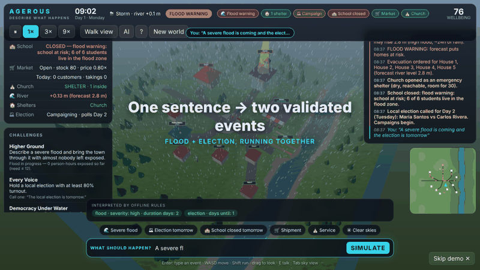

# AGEROUS

### Type what happens. A living 3D town reacts — for real.

**A browser-native 3D game where plain language is the controller.** Say *"A severe flood is coming and the election is tomorrow"* and the river rises over real terrain, roads go under, the school closes, civil defence opens a shelter, and 25 residents decide for themselves whether to flee, vote, or go to work.



| ✍ You type | 🧠 AI proposes | ✅ Schema validates | 🌍 Simulation decides | 🎥 3D renders |
|---|---|---|---|---|
| any sentence | structured events only | unknown → rejected, numbers clamped | physics + rules + needs | reads state, never writes it |

**The one idea:** the AI never touches the world. It only *proposes* events; a validator and a deterministic simulation decide what they mean. That is why it is safe, testable and reproducible.

### The idea, enforced — not asserted

| The AI is allowed to… | …and is structurally prevented from… | Proven by (`npm test`) |
|---|---|---|
| propose events from a fixed schema | inventing event types or structures | `AI hallucinations are rejected by the validator, not executed` · `build: schema rejects hallucinated structures/targets…` |
| answer "unsupported" | being silently replaced by a guess | `AI says unsupported → rejected honestly (no silent fallback to a guess)` |
| voice a resident in character | changing the world by talking | `talk: offline replies are grounded in state and never change the world` |
| sit behind your server proxy | leaking the key or being redirected | `proxy: the key stays server-side…` · `server: LLM_BASE_URL selects any gateway from env only; request bodies cannot redirect it` |
| be wrong or off-topic | corrupting the world | `unsupported requests are rejected with guidance, never faked` · `fuzz: 40 random prompts over 12 days on 8 seeds never break an invariant` |
| submit a leaderboard run | claiming a score it didn't earn | `replay: same run → same score; different runs → different scores; tampered runs are rejected` |

### Measured

| Claim | Number | Reproduce with |
|---|---|---|
| Server verification is cheap and exact | full 4-day Storm Day replay in ~100–280 ms; identical score on every run | `npm run measure` |
| Unit tests | 69 passing (physics, determinism, replay, interpreter, persistence, chat, proxy) | `npm test` |
| Browser flows | 28 end-to-end checks incl. a phone viewport | `npm run e2e` |
| Payload | ~40 kB (app) + ~125 kB (three.js) gzipped | `npm run build` |

Numbers were taken on a software-rendered cloud container, so treat the timings as an upper bound on a normal laptop.

**Try it in 10 seconds:** open the page → press **▶ Watch a flood unfold**. No key, no install, no account.

## What makes it different from "an AI game"

- **Everything runs together.** School, market, church, homes, the river and an election are all live at once. Floods close the market *and* the polling station *and* the school, and the town works through it.
- **The town lives without you.** 30 simulated days with no input: teachers teach, vendors sell, farmers harvest, people eat and get paid, Sunday service fills the pews. Take away the teacher and lessons really cancel.
- **Causality you can see.** A chip strip shows what is running; a chain of consequences (*You → flood → Main Road impassable → shelter opened*) appears after every sentence; click anyone to read **why** they are doing what they do.
- **It remembers.** Reload the page and the water level, votes, positions and history return.
- **Say it, and it exists.** *"Build a levee around the market"* raises a real wall in 3D **and** changes the flood physics: the same flood that swamps the market now leaves it dry. Sandbags, levee and flood wall have different heights, and a high flood overtops sandbags.
- **Talk to residents.** Click anyone and ask them something. With an LLM they answer in character, grounded only in facts from the world (needs, activity, river level, town news); without one, rules write the reply. Conversation never changes the world.
- **Cause and effect on one chart.** A *Wellbeing over time* graph sits under the town panel, with river level behind the line and a marker at every sentence you typed, so you can see what each one did.
- **A storm you can hear.** Rain, wind, river, thunder after real lightning flashes, a church bell for services and shelters, and warning tones — all synthesised live with Web Audio (no audio files). Toggle with 🔊.
- **Plays on a phone.** On touch devices you get a thumb joystick, a Talk button, scrolling prompt chips and a layout that fits a small screen (add `?touch` to force it).
- **Compete.** **🏆 Storm Day** is a fixed town with a fixed disaster (flood + blocked market road + school shut + election in two days). You get 5 sentences. The score (/1000: safety, services, democracy, wellbeing) is **verified by replaying your run on the server**, so it can't be faked. There is a live leaderboard and a global chat.
- **Honest.** 69 unit tests, browser end-to-end flows, and an [audit](AUDIT.md) of what was fake before and what is verified now.

Type **"A severe flood is coming."** and the river rises over real terrain. Low ground floods first: the fields, the riverside houses, then the market. Roads go under, the supply truck turns back, and the school closes. Civil defence opens the driest reachable building as a shelter, and the residents walk there along the roads that are still open. Once the water falls, they clean up, reopen and go home. All of it is written to a history that survives a page reload.

Then type **"The local election is tomorrow."** Campaigners canvass the square, voters walk to the polling station, and ballots count only when someone *arrives*. If you do both at once, turnout drops.

## What it is, who it's for

| | |
|---|---|
| **What** | A small, real simulation of a community (school, market, church, polling station, 5 houses, farm fields, a river, 25 residents) with a natural-language interface and a walkable 3D world. |
| **For** | **Players and judges** who want to see "AI → world" that really changes simulated state. **Educators and civic-planning teams** who want a cheap sandbox for explaining cascading risk (flood → roads → markets → schools → shelters → turnout). **Builders** who want a clean reference for a safe LLM-to-simulation pattern. |
| **Why AI?** | Natural language is the *input device*. It lets anyone author events and scenarios without programming the simulation. |
| **Why not just let the AI drive?** | The LLM can only emit events from a fixed, validated schema. The simulation decides what they mean. |

## Play

```bash
npm install
npm run dev        # http://localhost:5173
```

| Key | Action |
|---|---|
| **Enter** | Focus the prompt box and type an event |
| **W A S D** / arrows, **Shift** | Walk, run (deep water slows you; buildings are solid) |
| Drag / wheel | Look / zoom |
| **E** or click a person | Inspect them: what they're doing **and why**, their needs, money, routine |
| **Tab** | Toggle walk view and sky view |
| **Space** | Pause. The speed buttons give 1× / 3× / 9× |

Things to type:

- `A severe flood is coming` · `a minor flood tomorrow` · `heavy rain`
- `The local election is tomorrow` · `the election is today`
- `School is closed tomorrow` · `exam day at school` · `school reopens`
- `A large food shipment arrived at the market` · `the market road is blocked`
- `Sunday service this morning` · `it is sunny now` · `clean-up crews are out`
- Compound sentences: `A severe flood is coming and the election is tomorrow`
- Nonsense (`make it snow dragons`) is **rejected with an explanation**. The world is not changed.

The **Challenges** panel scores you from world state: bring the town through a flood with almost nobody exposed, reach 80% turnout, finish an election during a flood warning, or fill the pews on Sunday.

## How it works

```
 your sentence
      │
      ▼
 Interpreter ── LLM (OpenAI / Anthropic, bring-your-own-key)  ┐ both only PROPOSE events
      │         or offline rule parser (no key, no network)   ┘
      ▼
 Schema validator ── unknown types rejected · fields stripped · numbers clamped
      ▼
 Event handlers ───→ change WORLD STATE (src/simulation/events.js)
      ▼
 World state (plain JSON, the single source of truth)
      ▼
 Rules, every simulated quarter-hour (src/simulation/policies.js, npcs.js)
   civil defence · school · market · church · election · each NPC's decision
      ▼
 Renderer (three.js) READS state: water surface, people, signs, beacons, sky
```

- **Physics, not scripts.** A river stage in metres is compared against the same `terrainHeight()` the renderer draws. Roads are a graph and flood section by section. Severity changes the peak (1.3 / 2.2 / 2.8 m), so a *low* flood really is milder than a *high* one.
- **Shelters are chosen by rule** (dry, outside the forecast zone, reachable, has capacity, driest first). Nothing says "church". If the church is flooded, a different building gets used. If nothing qualifies, residents are stranded and the history says so.
- **People walk** along the road graph at a fixed pace. A flooded road can really cut someone off. Every decision carries a human-readable `reason`.
- **Market economy:** stock, price, sales and customers all come from who can actually arrive. A truck restocks it at 06:00 only if the road is open.
- **Election:** campaigners persuade the people they meet in the square. Floods and high prices nudge voters. Votes are counted on arrival at the polling station. If the polling station is flooded, the election is postponed.
- **Determinism:** one seeded RNG lives inside the world, so the same seed and prompts give the same history. That is what makes the 69 tests meaningful.
- **Memory:** the whole world autosaves to `localStorage`. Reload and the clock, flood, votes, positions and history come back.

## The AI interpreter — works with any provider

It works **out of the box offline**. To use an LLM, click **AI** and pick:

| Option | What you enter |
|---|---|
| OpenAI / Anthropic | key (+ optional model) |
| **Any OpenAI-compatible API** | **base URL** + key + model. Presets: OpenRouter, Groq, Together, DeepSeek, Mistral, Gemini, Ollama, LM Studio. Any gateway, router or "free model" relay that speaks `/chat/completions` works. |
| **Any Anthropic-compatible API** | **base URL** + key + model (`/v1/messages`) |
| Server proxy | your own deployment URL; the key stays on the server |

Base URLs are normalised (a pasted `.../v1/chat/completions` still works). Gateways that reject `response_format` get an automatic plain retry. The LLM never sees or touches the world: its JSON goes through the same validator as the offline parser, so hallucinated events are dropped. If the call fails (including browser **CORS** blocks, which many gateways have) Agerous falls back to the offline rules and tells you why. For gateways that block browsers, use the server proxy with `LLM_BASE_URL`.

> A key typed into the AI dialog stays in your browser's localStorage and goes only to the base URL you set.

## Deploy (Vercel)

The repo deploys as-is: a Vite static build plus serverless functions in `api/`: `interpret`, `npc`, `leaderboard`, `chat`.

**Environment variables** (Vercel → Settings → Environment Variables):

| Variable | Purpose |
|---|---|
| `LLM_BASE_URL`, `LLM_API_KEY`, `LLM_MODEL` | **Any** OpenAI-compatible gateway for the hosted demo. Add `LLM_API_STYLE=anthropic` for an Anthropic-compatible one. |
| *or* `OPENAI_API_KEY` / `ANTHROPIC_API_KEY` (+ `*_MODEL`) | The official APIs |
| `KV_REST_API_URL` + `KV_REST_API_TOKEN` | **Durable** leaderboard and chat. Add the *Upstash for Redis* integration from the Vercel Marketplace and these are set for you (`UPSTASH_REDIS_REST_URL/TOKEN` also work). Without it, scores and chat live in server memory and reset on restart. The UI says so. |
| `LLM_RATE_PER_MIN`, `LB_RATE_PER_MIN`, `CHAT_RATE_PER_MIN`, `ALLOW_ORIGIN` | Optional limits |
| `CHAT_ADMIN_KEY` | Lets you clear the chat: `POST /api/chat {"action":"clear","key":"…"}` |
| `CHAT_DISABLED=1` | Turn the chat off |
| `SITE_URL` | Optional. Absolute site URL for the social-preview image (`og:image`). On Vercel the production URL is picked up automatically. |

With no LLM variables the game falls back to the offline rules. Locally, run `node server/proxy.mjs` next to `npm run dev` (Vite forwards `/api`) to get every route.

**Why the leaderboard is trustworthy:** the simulation is deterministic and advances in whole one-minute ticks, so the same seed plus the same events at the same ticks always produces the identical world. The browser sends only *what you typed as validated events and when*. The server re-validates them and replays the whole scenario itself (~0.3 s), then computes the score. Client-claimed scores are ignored.

## Development

```bash
npm test          # 69 tests: physics, determinism, replay-verified leaderboard, chat, institutions, autonomy, concurrency fuzz, election, interpreter, proxy, schema, persistence
npm run build     # production bundle in dist/
npm run e2e       # Playwright flows A–H (flood, election, invalid input, persistence, building, talking, Storm Day + leaderboard + chat, sound/graph/lightning/phone) against `vite preview` (needs Chromium)
```

```
src/simulation/   geography · pathing · world · events · policies · npcs · engine · schema · interpreter · persistence · challenges
src/renderer/     scene.js (terrain, water, buildings, people, sky) · player.js (avatar + cameras)
src/ui/           HUD, history, inspector, minimap
test/             node:test suites (no dependencies)
e2e/              browser end-to-end script
```

## Honest limitations

- The simulation is deliberately small: one valley, 25 residents, rule-based behaviour. These are **rule-driven agents, not autonomous AI agents**.
- The offline parser understands a fixed vocabulary. The LLM path is covered by mocked tests, because live providers need your key.
- The visuals are low-poly by design. The production bundle is about 600 kB (three.js is code-split). Rendering quality adapts to frame rate; only software rendering has been measured.
- See [AUDIT.md](AUDIT.md) for what the original repo claimed, what was fake, and what is now verified.

## License

MIT
