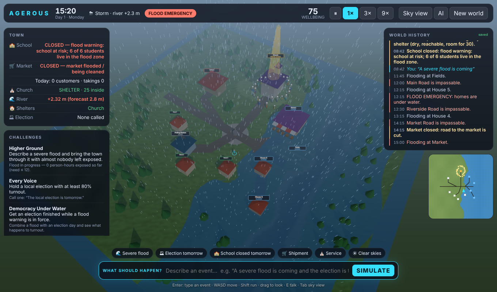

# AGEROUS

> **Describe what happens. Watch the world live through it.**

Agerous is a 3D game that runs in your browser. You walk around a small valley town, and you play it by **typing events in plain language**. The town does not play an animation. It *runs the consequences*.



Type **"A severe flood is coming."** and the river rises over real terrain. Low ground floods first: the fields, the riverside houses, then the market. Roads go under, the supply truck turns back, and the school closes. Civil defence opens the driest reachable building as a shelter, and the residents walk there along the roads that are still open. Once the water falls, they clean up, reopen and go home. All of it is written to a history that survives a page reload.

Then type **"The local election is tomorrow."** Campaigners canvass the square, voters walk to the polling station, and ballots count only when someone *arrives*. If you do both at once, turnout drops.

## What it is, who it's for

| | |
|---|---|
| **What** | A small, real simulation of a community (school, market, church, polling station, 5 houses, farm fields, a river, 25 residents) with a natural-language interface and a walkable 3D world. |
| **For** | **Players and judges** who want to see "AI → world" that really changes simulated state. **Educators and civic-planning teams** who want a cheap sandbox for explaining cascading risk (flood → roads → markets → schools → shelters → turnout). **Builders** who want a clean reference for a safe LLM-to-simulation pattern. |
| **Why AI?** | Natural language is the *input device*. It lets anyone author events and scenarios without programming the simulation. |
| **Why not just let the AI drive?** | The LLM can only emit events from a fixed, validated schema. The simulation decides what they mean. |

## Play

```bash
npm install
npm run dev        # http://localhost:5173
```

| Key | Action |
|---|---|
| **Enter** | Focus the prompt box and type an event |
| **W A S D** / arrows, **Shift** | Walk, run (deep water slows you; buildings are solid) |
| Drag / wheel | Look / zoom |
| **E** or click a person | Inspect them: what they're doing **and why**, their needs, money, routine |
| **Tab** | Toggle walk view and sky view |
| **Space** | Pause. The speed buttons give 1× / 3× / 9× |

Things to type:

- `A severe flood is coming` · `a minor flood tomorrow` · `heavy rain`
- `The local election is tomorrow` · `the election is today`
- `School is closed tomorrow` · `exam day at school` · `school reopens`
- `A large food shipment arrived at the market` · `the market road is blocked`
- `Sunday service this morning` · `it is sunny now` · `clean-up crews are out`
- Compound sentences: `A severe flood is coming and the election is tomorrow`
- Nonsense (`make it snow dragons`) is **rejected with an explanation**. The world is not changed.

The **Challenges** panel scores you from world state: bring the town through a flood with almost nobody exposed, reach 80% turnout, finish an election during a flood warning, or fill the pews on Sunday.

## How it works

```
 your sentence
      │
      ▼
 Interpreter ── LLM (OpenAI / Anthropic, bring-your-own-key)  ┐ both only PROPOSE events
      │         or offline rule parser (no key, no network)   ┘
      ▼
 Schema validator ── unknown types rejected · fields stripped · numbers clamped
      ▼
 Event handlers ───→ change WORLD STATE (src/simulation/events.js)
      ▼
 World state (plain JSON, the single source of truth)
      ▼
 Rules, every simulated quarter-hour (src/simulation/policies.js, npcs.js)
   civil defence · school · market · church · election · each NPC's decision
      ▼
 Renderer (three.js) READS state: water surface, people, signs, beacons, sky
```

- **Physics, not scripts.** A river stage in metres is compared against the same `terrainHeight()` the renderer draws. Roads are a graph and flood section by section. Severity changes the peak (1.3 / 2.2 / 2.8 m), so a *low* flood really is milder than a *high* one.
- **Shelters are chosen by rule** (dry, outside the forecast zone, reachable, has capacity, driest first). Nothing says "church". If the church is flooded, a different building gets used. If nothing qualifies, residents are stranded and the history says so.
- **People walk** along the road graph at a fixed pace. A flooded road can really cut someone off. Every decision carries a human-readable `reason`.
- **Market economy:** stock, price, sales and customers all come from who can actually arrive. A truck restocks it at 06:00 only if the road is open.
- **Election:** campaigners persuade the people they meet in the square. Floods and high prices nudge voters. Votes are counted on arrival at the polling station. If the polling station is flooded, the election is postponed.
- **Determinism:** one seeded RNG lives inside the world, so the same seed and prompts give the same history. That is what makes the 37 tests meaningful.
- **Memory:** the whole world autosaves to `localStorage`. Reload and the clock, flood, votes, positions and history come back.

## The AI interpreter

It works **out of the box offline**. To use an LLM, click **AI**, pick a provider, and paste a key. The model is editable, and the defaults are `gpt-4o-mini` and `claude-haiku-5-5`. The LLM never sees or touches the world. Its JSON goes through the same validator as the offline parser, so hallucinated events are dropped. If the call fails, Agerous falls back to the offline rules and tells you so.

> The key lives in your browser's localStorage and goes straight to the provider. That is fine for a demo. For a public deployment, put a tiny proxy in front of the provider call and keep the key server-side.

## Development

```bash
npm test          # 37 tests: physics, institutions, election, interpreter, schema, persistence
npm run build     # production bundle in dist/
npm run e2e       # Playwright flows A–D against `vite preview` (needs Chromium)
```

```
src/simulation/   geography · pathing · world · events · policies · npcs · engine · schema · interpreter · persistence · challenges
src/renderer/     scene.js (terrain, water, buildings, people, sky) · player.js (avatar + cameras)
src/ui/           HUD, history, inspector, minimap
test/             node:test suites (no dependencies)
e2e/              browser end-to-end script
```

## Honest limitations

- The simulation is deliberately small: one valley, 25 residents, rule-based behaviour. These are **rule-driven agents, not autonomous AI agents**.
- The offline parser understands a fixed vocabulary. The LLM path is covered by mocked tests, because live providers need your key.
- The visuals are low-poly by design. The deployed bundle is about 540 kB.
- See [AUDIT.md](AUDIT.md) for what the original repo claimed, what was fake, and what is now verified.

## License

MIT
