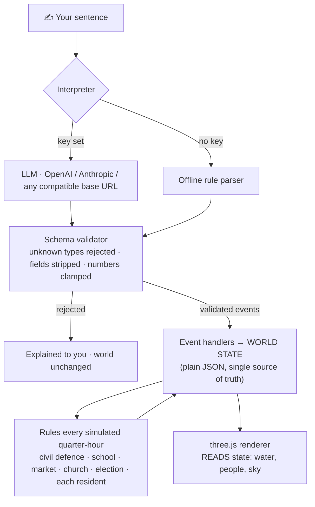
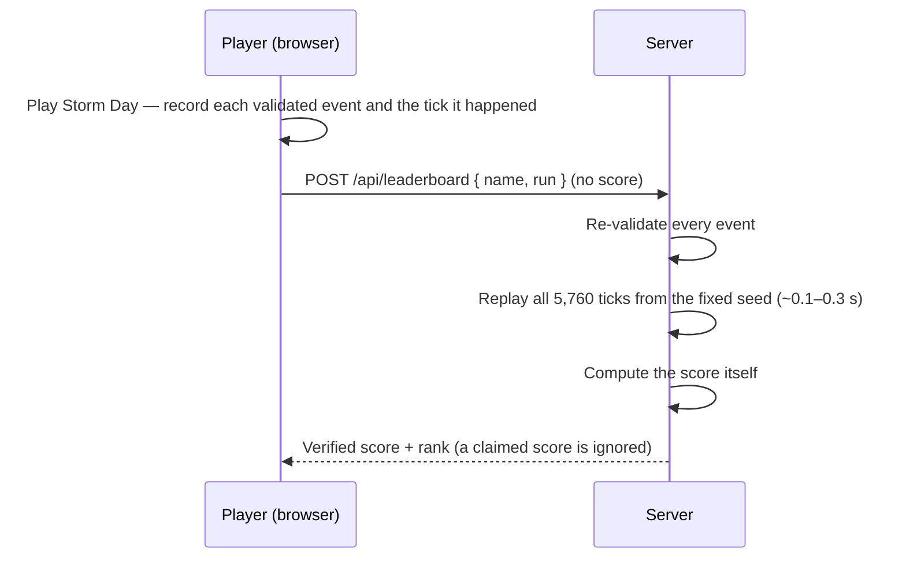

# AGEROUS

### Type what happens. A living 3D town reacts — for real.

> **The AI proposes. A validator checks. A deterministic simulation decides.**
> Language models are good at understanding intent and bad at being a world engine: they hallucinate state and can't be tested. Agerous uses the model for the one thing it is good at, and keeps everything that matters — water, roads, people, votes, scores — in code you can run, replay and verify.


Say *"A severe flood is coming and the election is tomorrow"* and the river rises over real terrain, roads go under, the school closes, civil defence opens a shelter, and 25 residents decide for themselves whether to flee, vote or go to work — all at once, all from one sentence.

**Links:** [Submission pack](SUBMISSION.md) · [Audit: what was fake, what is verified](AUDIT.md) · [Run it locally](#try-it-in-30-seconds) · [Deploy](#deploy-vercel)

| ✍ You type | 🧠 AI proposes | ✅ Schema validates | 🌍 Simulation decides | 🎥 3D renders |
|---|---|---|---|---|
| any sentence | structured events only | unknown → rejected, numbers clamped, max 3 events | physics + rules + needs | reads state, never writes it |

## Try it in 30 seconds

1. Open the page and press **▶ Watch a flood unfold**. No key, no account, no install.
2. Then type your own sentence: `Build a levee around the market` followed by `A severe flood is coming`. The market stays dry.
3. Try to break it: `summon a dragon over the church`. It is rejected with an explanation and the world stays **byte-identical**.
4. Press **🏆 Challenge**, play Storm Day with five sentences, and get a score the server re-computes itself.

```bash
npm install && npm run dev      # http://localhost:5173  (add `node server/proxy.mjs` for leaderboard + chat)
```

## The idea, enforced — not asserted

| The AI is allowed to… | …and is structurally prevented from… | Proven by (`npm test`) |
|---|---|---|
| propose events from a fixed schema | inventing event types or structures | `AI hallucinations are rejected by the validator, not executed` · `build: schema rejects hallucinated structures/targets…` |
| answer "unsupported" | being silently replaced by a guess | `AI says unsupported → rejected honestly (no silent fallback to a guess)` |
| voice a resident in character | changing the world by talking | `talk: offline replies are grounded in state and never change the world` |
| sit behind your server proxy | leaking the key or being redirected | `proxy: the key stays server-side…` · `server: LLM_BASE_URL selects any gateway from env only; request bodies cannot redirect it` |
| be wrong or off-topic | corrupting the world | `unsupported requests are rejected with guidance, never faked` · `fuzz: 40 random prompts over 12 days on 8 seeds never break an invariant` |
| submit a leaderboard run | claiming a score it didn't earn | `replay: same run → same score; different runs → different scores; tampered runs are rejected` |

### What the model does — and what it never does

| Used for | Never used for |
|---|---|
| Turning a free-form sentence into schema events | Water levels, road closures, who is stranded |
| Giving a resident a voice, grounded in real state | Any decision a resident makes (those are rules with a readable `reason`) |
| — | Votes, the market economy, scores, the leaderboard |

With no key at all, an offline rule parser does the interpreting, so the whole game works without a model.

### Measured

| Claim | Number | Reproduce with |
|---|---|---|
| Server verification is cheap and exact | full 4-day Storm Day replay in ~100–280 ms; identical score on every run | `npm run measure` |
| Unit tests | 69 passing (physics, determinism, replay, interpreter, persistence, chat, proxy) | `npm test` |
| Browser flows | 28 end-to-end checks incl. a phone viewport | `npm run e2e` |
| Payload | ~40 kB (app) + ~125 kB (three.js) gzipped | `npm run build` |

Timings were taken in a software-rendered cloud container, so treat them as an upper bound on a normal laptop.

## What you can do

- **Everything runs together.** School, market, church, homes, the river and an election are all live at once. A flood closes the market *and* the polling station *and* the school, and the town works through it.
- **The town lives without you.** 30 simulated days with no input: teachers teach, vendors sell, farmers harvest, people eat and get paid, Sunday service fills the pews. Remove the teacher and lessons really cancel.
- **See causality.** A chip strip shows what is running; a chain (*You → flood → Main Road impassable → shelter opened*) appears after every sentence; click anyone to read **why** they are doing what they do. A *Wellbeing over time* graph marks each sentence you typed against the river level.
- **Say it, and it exists.** *"Build a levee around the market"* raises a real wall in 3D **and** changes the flood physics. Sandbags, levee and flood wall have different heights; a high flood overtops sandbags.
- **Talk to residents.** Ask anyone anything. They answer in character from real facts (needs, activity, river level, town news). Conversation never changes the world.
- **It remembers.** Reload and the clock, water level, votes, positions and history return.
- **Hear the storm.** Rain, wind, river, thunder timed to lightning, a church bell and warning tones — synthesised live with Web Audio, no audio files. Toggle with 🔊.
- **Play on a phone.** A thumb joystick, a Talk button and a layout that fits small screens (`?touch` forces it).
- **Compete.** **🏆 Storm Day** is a fixed disaster (flood + blocked market road + school shut + an election in two days). You get 5 sentences. The score (/1000: safety 300 · services 300 · democracy 250 · wellbeing 150) is verified by **replaying your run on the server**. Live leaderboard and global chat.

### Things to type

- `A severe flood is coming` · `a minor flood tomorrow` · `heavy rain`
- `The local election is tomorrow` · `the election is today`
- `School is closed tomorrow` · `exam day at school` · `school reopens`
- `A large food shipment arrived at the market` · `the market road is blocked`
- `Sunday service this morning` · `it is sunny now` · `clean-up crews are out`
- `Build a levee around the church` · compound sentences such as `A severe flood is coming and the election is tomorrow`

| Key | Action |
|---|---|
| **Enter** | Focus the prompt box |
| **W A S D** / arrows, **Shift** | Walk, run (deep water slows you; buildings are solid) |
| Drag / wheel | Look / zoom |
| **E** or click a person | Inspect: what they're doing **and why**, needs, money, routine |
| **Tab** · **Space** | Walk/sky view · pause (speed buttons: 1× / 3× / 9×) |

## How it works



- **Physics, not scripts.** The river stage (metres) is compared against the same `terrainHeight()` the renderer draws. Roads are a graph and flood section by section. Severity changes the peak (1.3 / 2.2 / 2.8 m), so a *low* flood really is milder than a *high* one.
- **Shelters are chosen by rule** (dry, outside the forecast zone, reachable, has capacity, driest first). Nothing says "church": if the church floods, another building is used; if nothing qualifies, residents are stranded and the history says so.
- **People walk** the road graph at a fixed pace, so a flooded road can really cut someone off. Every decision carries a readable `reason`.
- **Market economy:** stock, price, sales and customers come from who can actually arrive. A truck restocks it at 06:00 only if the road is open.
- **Election:** campaigners persuade people they meet in the square; floods and prices nudge voters; votes count only on *arrival* at the polling station; a flooded station postpones the vote.
- **Determinism:** one seeded RNG lives inside the world, so the same seed and the same sentences give the same history. That is what makes the tests meaningful and the leaderboard verifiable.

### Why the leaderboard can't be faked



The simulation advances in whole one-minute ticks, so the same seed plus the same events at the same ticks always produces the identical world.

## The AI interpreter — works with any provider

It works **out of the box offline**. To use an LLM, click **AI** and pick:

| Option | What you enter |
|---|---|
| OpenAI / Anthropic | key (+ optional model) |
| **Any OpenAI-compatible API** | **base URL** + key + model. Presets: OpenRouter, Groq, Together, DeepSeek, Mistral, Gemini, Ollama, LM Studio. Anything that speaks `/chat/completions` works. |
| **Any Anthropic-compatible API** | **base URL** + key + model (`/v1/messages`) |
| Server proxy | your own deployment URL; the key stays on the server |

Base URLs are normalised (a pasted `.../v1/chat/completions` still works). Gateways that reject `response_format` get an automatic plain retry. The LLM's JSON goes through the same validator as the offline parser, so hallucinated events are dropped. If a call fails (including browser **CORS** blocks) Agerous falls back to the offline rules and tells you why. For gateways that block browsers, use the server proxy.

> A key typed into the AI dialog stays in your browser's localStorage and goes only to the base URL you set.

## Deploy (Vercel)

The repo deploys as-is: a Vite static build plus serverless functions in `api/` (`interpret`, `npc`, `leaderboard`, `chat`).

| Variable | Purpose |
|---|---|
| `LLM_BASE_URL`, `LLM_API_KEY`, `LLM_MODEL` | **Any** OpenAI-compatible gateway for the hosted demo. Add `LLM_API_STYLE=anthropic` for an Anthropic-compatible one. |
| *or* `OPENAI_API_KEY` / `ANTHROPIC_API_KEY` (+ `*_MODEL`) | The official APIs |
| `KV_REST_API_URL` + `KV_REST_API_TOKEN` | **Durable** leaderboard and chat. The *Upstash for Redis* Marketplace integration sets these (`UPSTASH_REDIS_REST_URL/TOKEN` also work). Without it, scores and chat live in server memory and reset on restart — the UI says so. |
| `LLM_RATE_PER_MIN`, `LB_RATE_PER_MIN`, `CHAT_RATE_PER_MIN`, `ALLOW_ORIGIN` | Optional limits |
| `CHAT_ADMIN_KEY` | Lets you clear the chat: `POST /api/chat {"action":"clear","key":"…"}` |
| `CHAT_DISABLED=1` | Turn the chat off |
| `SITE_URL` | Optional absolute URL for the social-preview image. On Vercel the production URL is picked up automatically. |

With no LLM variables the game falls back to the offline rules. Locally, run `node server/proxy.mjs` next to `npm run dev` (Vite forwards `/api`) to get every route.

## Development

```bash
npm test          # 69 tests: physics, determinism, replay-verified leaderboard, chat, institutions, autonomy, concurrency fuzz, election, interpreter, proxy, schema, persistence
npm run measure   # replay timing + determinism check for Storm Day
npm run build     # production bundle in dist/
npm run e2e       # Playwright flows A–H against `vite preview` (needs Chromium; start `node server/proxy.mjs` first)
```

```
src/simulation/   geography · pathing · world · events · policies · npcs · engine · schema · interpreter · llm · scenario · persistence
src/renderer/     scene.js (terrain, water, buildings, people, sky, lightning) · player.js (avatar + cameras)
src/ui/           HUD, history, inspector, minimap, touch controls, social (leaderboard + chat)
src/audio.js      procedural Web Audio soundscape
server/ · api/    shared handlers · Vercel serverless routes
test/ · e2e/      node:test suites (no dependencies) · browser end-to-end script
```

## Honest limitations

- The simulation is deliberately small: one valley, 25 residents. Residents follow **rules, not autonomous AI agents**; the model gives them a voice, not their decisions.
- The offline parser understands a fixed vocabulary and rejects unusual phrasing rather than guessing.
- The live OpenAI/Anthropic paths are covered by mocked tests; live providers need your key.
- A public hosted demo exposes an LLM key and an open chat: both need a spend cap and real moderation (built in: rate limits, link stripping and a basic profanity filter — not a substitute for moderating a public chat).
- The visuals are low-poly by design. Frame rate has only been measured on software rendering. The bundle is ~600 kB raw, split so three.js loads separately.
- [AUDIT.md](AUDIT.md) lists what the original repo claimed, what was fake, and what is now verified.

## License

MIT
